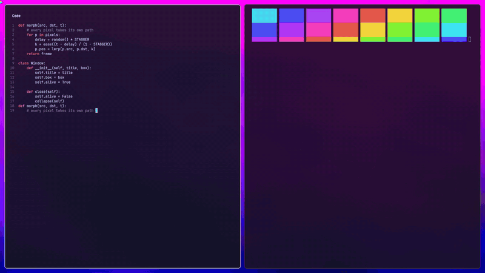

# hyprmorph — pixel morph for Hyprland

Every window change is a swarm of pixels. A Hyprland plugin that turns window and workspace changes into a pixel morph, inspired by the page morph of a custom SteelSeries Arctis OLED daemon. Pixels break off, each with its own delay and arc, and fly into their new places.

**Demo and details: https://guizzan.github.io/hyprmorph/**

[](https://guizzan.github.io/hyprmorph/)

## What it does

- **Workspace switch** — The content of the old desktop flies, pixel by pixel, into the content of the new one. Pixels that are the same on both stay put; new content streams in from the side you switch toward.
- **Open / close / resize / fullscreen** — Windows that change are rebuilt from their own pixels: each pixel flies from its spot in the old box to the same spot in the new one. Only pixels that actually changed move.
- **Liquid-window drag** — Drag a window (SUPER + mouse) and it becomes a fixed-size blob made of its own pixels, still laid out like the window, with a wobbling outline, a liquid stretch along the movement and a short trail. Drop it and it flies back into place.
- **Live destination** — The target picture is captured every frame, so moving content (video, terminals) keeps updating during the morph.
- **Customizable** — A small settings app (hyprmorph-settings) tunes it live: pixel colours (the windows' own, the wallpaper theme, or custom colours), pixel size, detail, duration, stagger, path curve, which changes morph, and the drag blob's size, trail and wobble.

## Install

Built and tested against **Hyprland 0.56** (Lua config). Plugins are tied to the exact Hyprland version — rebuild after every update.

```sh
make            # builds hyprmorph-dev.so
make install    # copies it to hyprmorph.so with a new inode (safe while Hyprland runs)
```

In your Lua config:

```lua
pcall(hl.plugin.load, os.getenv("HOME") .. "/path/to/hyprmorph/hyprmorph.so")
-- the plugin replaces Hyprland's own window and workspace animations
for _, leaf in ipairs({ "workspaces", "windowsIn", "windowsOut", "windowsMove", "fadeIn", "fadeOut" }) do
    hl.animation({ leaf = leaf, enabled = false })
end
```

Then log out and back in. Never hot-swap the plugin in a running session (unloading it can crash Hyprland), and run only one of these effect plugins at a time.

Try it in a nested session first: `Hyprland -c test/hyprland.lua`.

## Settings

A small settings app (GTK 4 + libadwaita) tunes the effect live: every change is saved at once and used from the
next animation; its **Preview** button switches to the next workspace and back. Install it and bind it to a key:

```sh
ln -s "$PWD/settings/hyprmorph-settings" ~/.local/bin/
ln -s "$PWD/settings/hyprmorph-settings.desktop" ~/.local/share/applications/   # app menu entry
```

```lua
hl.bind("SUPER + ALT + M", hl.dsp.exec_cmd(os.getenv("HOME") .. "/.local/bin/hyprmorph-settings"), { description = "Morph settings" })
```

Or edit `~/.config/hyprmorph/settings.conf` by hand. The plugin re-reads the file (and, in theme mode, the
matugen colours in `~/.config/ml4w/colors/colors.json`) between morphs.

| key | default | |
|---|---|---|
| `morph_workspaces`, `morph_windows`, `drag_blob` | `true` | which changes are animated |
| `color_mode` | `window` | `window` (the windows' own colours), `theme` (primary/tertiary from the wallpaper theme), `custom` |
| `color_strength` | `0.7` | how strongly flying pixels take the colour |
| `custom_color`, `custom_color2` | | colours for `custom` mode (pixels get a mix of the two) |
| `pixel_size` | `3` | size of a pixel, physical px |
| `detail` | `0.10` | contrast that counts as content; lower = more pixels fly |
| `duration`, `stagger`, `curl` | `0.3`, `0.35`, `0.18` | seconds, take-off spread, path bend |
| `blob_size`, `blob_trail`, `blob_wobble` | `160`, `1.6`, `1.0` | drag blob: half its longer side, tail length in blob sizes, outline wobble |
| `bar_pixels`, `bar_pixel_density`, `bar_pixel_react` | `true`, `1.0`, `1.0` | floating pixels in the ML4W bar and dock (see below) |

## Floating pixels in the ML4W bar and dock

`extras/ml4w-bar-pixels/` replaces the pill background of the
[ML4W](https://github.com/mylinuxforwork/dotfiles) Quickshell bar and its dock with a dense cloud of floating, twinkling pixels in the theme colours. The cursor pushes them
away like a force field and sheds sparks as it moves; expanding the bar throws a burst. Install with
`extras/ml4w-bar-pixels/patch-pixels.sh` (idempotent; re-run after ML4W updates). It reads the same settings file.

## See also

[hyprliquid](https://github.com/Guizzan/hyprliquid) (liquid) · [hyprhole](https://github.com/Guizzan/hyprhole) (black hole)
